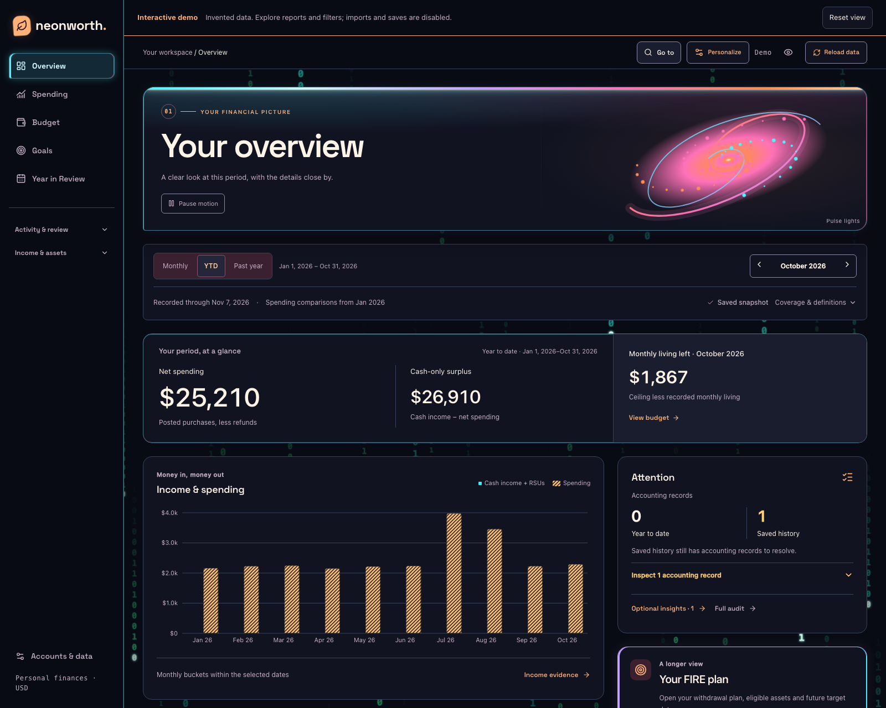
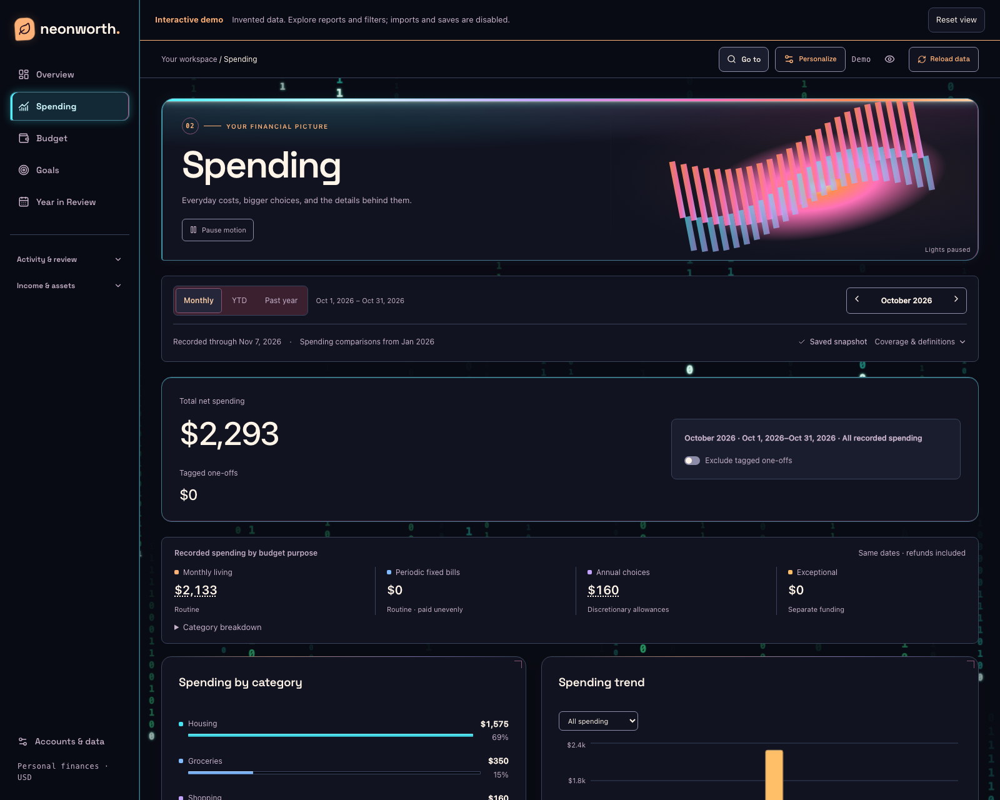

<div align="center">

# Neonworth

**Your money. Decoded in neon.**

An open-source finance dashboard with a cyberpunk design: Matrix-inspired binary rain, neon charts, and a clear view of spending, net worth, and financial goals.

[](https://github.com/yaokaiy/neonworth/actions/workflows/ci.yml)
[](LICENSE)
[](docs/RELEASE_STATUS.md)

[Live demo](https://yaokaiy.github.io/neonworth/) · [Use with ChatGPT](#use-with-chatgpt) · [Try locally](#try-it-locally) · [Data format](docs/IMPORTING.md) · [Deployment](docs/DEPLOYMENT.md) · [Contributing](CONTRIBUTING.md)

</div>

Turn your financial history into a personal control room. Follow cash flow, understand where spending goes, and plan toward the goals you choose—from next month's budget to financial independence.

Inspect the transactions behind your spending, and save corrections alongside the original evidence. Supported card repayments stay separate from spending; gaps in source coverage stay visible.

[](https://yaokaiy.github.io/neonworth/)

*Warm and cool neon. Binary rain. Charts that feel like instruments. These are real application screenshots with invented data—[step inside the demo](https://yaokaiy.github.io/neonworth/) to explore the atmosphere and the reports.*

<details>
<summary>See the spending view</summary>



</details>

**Take the controls:** switch reports, change dates, inspect transactions, hide amounts, or turn on Quiet mode. The public demo needs no signup or bank connection. All records are invented; imports and financial saves are disabled. [Run the full app locally](#try-it-locally) to use your own data, or read [how the demo is built](docs/DEMO.md).

## Your financial control room

- **Read your spending:** explore categories and compare monthly, year-to-date and rolling-year reports alongside dated net-worth observations.
- **Follow the evidence:** search transactions, choose their categories, and save accounting corrections while preserving original records. Supported repayments and refunds reconcile with their source evidence.
- **Give your budget a purpose:** set monthly limits and annual allocations, then inspect actual spending and the history available to support it.
- **Model your path to FIRE:** enter withdrawal needs, rates, eligible assets and future target dates. Explore optional projections using assumptions you choose.
- **Replay your year:** revisit large purchases and organize your own events, with linked refunds and transactions counted once.
- **Separate cash from equity:** understand cash income and received shares separately, with unknown prices and investment coverage kept explicit.
- **Choose your atmosphere:** continuous binary rain, neon bars and readable financial text, with Quiet mode, reduced-motion support and amount hiding.
- **Bring your AI agent:** use the included workflows to create a private Sites instance from authorized GPT Finance records, verify refreshes, and preserve saved records through upgrades and interruptions.

## Use with ChatGPT

**Already using GPT Finance? Give your data a home.**

For ChatGPT users with **Sites available and GPT Finance already connected and authorized**, this is the recommended managed-hosting path. Start with the [setup prompt](prompts/start.md): it guides your agent through creating a separate private Site and database, importing validated records, and verifying what was saved. Provider credentials and source-access capabilities stay outside the website.

| Your next move | Workflow |
| --- | --- |
| Create your workspace, or resume setup | [Start](prompts/start.md) |
| Bring your financial records up to date | [Refresh](prompts/refresh.md) |
| Install new code and keep your saved records | [Upgrade](prompts/upgrade.md) |
| Resolve an interrupted operation | [Recovery](prompts/recovery.md) |

The current data contract is USD-only. Tools must be available in the executing conversation; a missing tool does not mean your bank needs reconnecting. Recurring updates are optional and require verified unattended access. Refreshing data does not rebuild or redeploy the website.

You can also use the [workflow plugin and skill](prompts/README.md) where installation is supported; this repository does not claim a public-directory listing. For the technical boundaries, read the [Sites profile](profiles/sites/README.md), [Finance harness](integrations/gpt-finance/README.md), [delivery contract](docs/SITES_DELIVERY.md) and [release evidence](docs/RELEASE_STATUS.md).

## Try it locally

Use Node **26.8.1** (see `.node-version`). The installer uses pinned **pnpm 11.25.0**.

```sh
git clone https://github.com/yaokaiy/neonworth.git
cd neonworth
npm run install:ci
npm run demo
npm run dev
```

Open **http://127.0.0.1:5173**. The demo contains invented institutions, transactions and balances. `npm run demo` generates a new demonstration relative to today's date, applies local migrations and seeds only the local D1 database. It refuses to replace non-demo data or independent saved settings. It does not access a hosted database or a financial provider.

To start empty instead, run `npm run setup:local` and `npm run db:migrate:local`, then `npm run dev`. Import your own normalized JSON through Accounts & data after reviewing the [data contract](docs/IMPORTING.md).

## Make it yours

The default policy includes explicitly classified cash income, leaves unconfirmed payment purposes unresolved, and treats supported card repayments as movements. It does not assume an employer, that every person-to-person payment is a transfer, or that an unlinked card's payments represent a particular kind of spending.

Review `lib/finance-config.ts` before changing accounting conventions. Budget amounts and planning assumptions are entered in the app. The first release uses **USD amounts with two-decimal accounting**; it does not convert currencies or consolidate foreign-currency accounts. Do not import mixed-currency data as though it were USD.

The browser and application never receive bank or brokerage credentials. Collect and normalize exports outside the app. The raw refresh protocol is an optional adapter contract, not a working bank integration or automatic scheduler.

## Deployment

The app has two deployment profiles sharing its financial models, records and UI: [owner-private ChatGPT Sites](profiles/sites/README.md), and [Cloudflare Workers/D1 with Cloudflare Access](docs/DEPLOYMENT.md). The standalone profile rejects hosted requests when authentication is missing or invalid. The Sites profile uses the platform's confirmed private access boundary.

One instance belongs to one owner. Giving another person access to the same instance shares the same datastore; there is no multi-user tenancy model.

## Extend with your own data source or AI agent

Start with the [offline CSV adapter](integrations/README.md), the generated [dataset v1 schema](contracts/dataset-v1.schema.json), and the canonical `npm run import:validate` command. The [HTTP contract](docs/API.md) and [extension guide](docs/EXTENDING.md) explain the supported backend boundary. Point your coding agent to [the integration skill](skills/neonworth-integrations/SKILL.md) for implementation with synthetic fixtures and explicit acceptance criteria. A replacement database/backend is a separate implementation, not a configuration toggle.

## Development

```sh
npm run security:secrets
npm test
npm run typecheck
npm run security:audit
npm run build
```

The CSV adapter regression tests also require Python 3.10+ (`python3` on PATH). The app and synthetic local demo run without Python.

The stack is React, TypeScript, Vinext/Vite, Cloudflare Workers and D1, with Radix, Recharts and Zod. Next-shaped routes run through Vinext, not a stock Next.js server. Read [the architecture](docs/ARCHITECTURE.md) for boundaries and current capacity limits.

This is an initial alpha release. Terminal validation and browser acceptance are recorded separately in [release status](docs/RELEASE_STATUS.md). Financial reports depend on the evidence you import; source completeness, asset eligibility and future returns are not inferred.

## License

MIT. See [LICENSE](LICENSE) and [third-party notices](THIRD_PARTY_NOTICES.md). All included demo data is synthetic.
