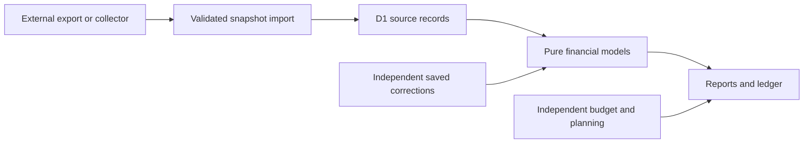

# Architecture

Neonworth is a single-user snapshot application. A separate, user-controlled collector or export tool produces data; the app validates, stores and interprets it. It has no bank connector capability.

## Runtime and authentication

React routes use Vinext, Vite and Cloudflare Workers. Cloudflare Access JWT validation runs before the application handler for UI, API and MCP requests. The configured issuer, audience and single owner must match; configured failures do not fall back to anonymous access. A tightly scoped development exception requires an explicit local flag and an HTTP loopback request. Production builds disable that flag.

Only storage bindings and lifecycle helpers reach the application handler. Provider credentials and connector capabilities are not forwarded. Write endpoints also enforce same-origin behavior. The MCP endpoint is protected by the same owner boundary; an external client must have compatible Access authentication. No automatic scheduler is bundled.

## Data ownership

- `lib/finance.ts`, `lib/periods.ts` and report modules interpret the source snapshot.
- `lib/classification.ts`, movement and review modules produce evidence-backed interpretations without rewriting source records.
- Transaction corrections, review preferences, retirement annotations, budgets and planning are independent stored records.
- Whole-record comparisons and atomic writes prevent a stale editor from silently replacing newer data.
- Refreshes stage a complete bounded source bundle, validate it, merge retained history and read back the committed outcome. Failed refreshes preserve the last good snapshot.

Imported source amounts follow the documented sign convention. Pending transactions, unknown purposes, partial source coverage and missing equity prices are not silently converted into certainty. Transfers and investment sales are separate from consumption and new income. Personal merchant exceptions belong in saved corrections, not shared code.

## Limits and growth

The current dataset format remains a bounded full snapshot: at most 50,000 bank transactions and 7,500,000 UTF-8 bytes, with 8,000,000-byte request bounds and per-record storage limits. D1 chunking supports atomic storage but does not make browser reads or report derivation paginated across the database. A large JSON export can exceed the single-request restore envelope when independent records are included.

Before increasing limits, measure payload size, Worker memory/CPU and browser interaction time. A future partitioned model needs revision-consistent queries, bounded restore batches and parity tests, not only more SQL indexes.

## Presentation

Financial values and chart geometry are static. Binary rain is isolated from report layout and pauses for quiet/reduced-motion preferences, hidden tabs and other supported visibility conditions. CSS color roles distinguish financial data and status from decoration. Amount hiding is a display control; it is not anonymization or encryption.

## Testing

All public tests and examples use synthetic records. Domain regressions cover accounting, scope, corrections and source evidence. Storage tests cover concurrency, corruption, recovery and independent-record preservation. Authentication tests cover denial cases. Browser keyboard, privacy and responsive checks remain separate evidence from server rendering and type checks.

## Public demonstration

The public demo is a separate Vite client build that reuses the actual reports, components, styles and financial models. Its build replaces the client transport with a synthetic read-only adapter; it includes neither the Worker nor a D1 database. Imports and financial saves are unavailable. Navigation, report periods, filters, drilldowns and display preferences remain interactive.

Query-based report URLs keep the demo within its GitHub Pages subdirectory and survive direct links and reloads. The authenticated application retains its existing URLs, transport and owner boundary. See [the demo guide](DEMO.md) for reproducible builds and publication.
